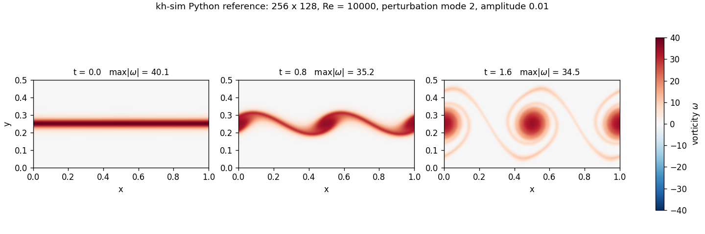

# lege-artis/kh-sim — engineer tier — 01: What kh-sim actually computes (EN)

> **Audience.** You have run the Hello-World of chapter [00](00-quick-start.md) and want the mental model behind the numbers: which equations, which flow, which questions the solver can answer and which it cannot.
>
> **Reading time.** About 15 minutes.
>
> **License.** CC-BY-SA-4.0 (text); the code snippets and the figure script are Apache-2.0.
>
> **Companion.** Canonical tier: [`kh-governing-equations.md`](../../../shared/canonical-equations/kh-governing-equations.md) (KH-GE) and [`kh-linear-stability.md`](../../../shared/canonical-equations/kh-linear-stability.md) (KH-LS). This chapter cites their equation labels and does not re-derive them.

---

## §1. The 2D vorticity–stream-function form

The Navier–Stokes equations can be written in several forms. kh-sim uses the **vorticity–stream-function** form for two-dimensional incompressible flow, because it removes the two things that make the primitive (u, v, p) form awkward:

- **No pressure.** Taking the curl of the momentum equation eliminates the pressure gradient. kh-sim never solves for a pressure.
- **Incompressibility by construction.** The velocity comes from a stream function ψ, `u = ∂ψ/∂y`, `v = −∂ψ/∂x` (KH-GE-3), which is divergence-free identically. There is no projection step to get wrong.

What remains is one scalar transport equation for the vorticity ω = ∂v/∂x − ∂u/∂y (KH-GE-1):

```text
∂ω/∂t + u ∂ω/∂x + v ∂ω/∂y = ν ∇²ω
```

The flow carries ω along (advection) and viscosity smears it out (diffusion). The velocity needed for the advection term is recovered at every stage of every step from the Poisson equation ∇²ψ = −ω (KH-GE-2), which in Fourier space is one division per mode (chapter [02](02-numerical-methods.md)). That loop — ω → ψ → (u, v) → advance ω — is the whole solver.

The viscosity is set by the Reynolds number: **ν = |U₀| / Re**, where U₀ is `velocity_shear`. Re is defined with a unit length, not with the layer width δ; the Reynolds number of the layer itself is Re·δ, which is 25 for the Hello-World request (Re = 1000, δ = 0.025) and 250 for the figure below (Re = 10000). A reversed shear (U₀ < 0) is the mirrored flow with the same viscosity, not a negative one; `velocity_shear = 0` is an inviscid run and is reported as a warning.

## §2. The Kelvin–Helmholtz instability

The canonical initial condition (KH-GE-4) is a shear layer with a small ripple:

```text
u(x, y, 0) = −U₀ tanh((y − L_y/2) / δ)         the shear layer
v(x, y, 0) = A sin(2π m x / L_x)               the ripple, mode m, amplitude A
```

Its vorticity is a sheet of width δ, `ω = (U₀/δ) sech²((y − L_y/2)/δ)`, plus the ripple's contribution. For U₀ > 0 the upper stream moves in −x and the lower one in +x. (KH-GE v0.1 wrote `+U₀ tanh`; the vorticity, which is what every backend computes, belongs to `−U₀ tanh`, and the canonical text was corrected on 2026-10-12. The two flows are mirror images; nothing in the dynamics depends on which one you look at.) In the request path the layer width is fixed at **δ = L_y/20**; `perturbation_mode` is m and `perturbation_amplitude` is A. Any other initial condition goes in as `initial_omega` (§3).

The physics is the textbook one. The shear amplifies the ripple: where the interface bulges into a stream, that stream is squeezed, speeds up and its pressure drops; where it recedes, the stream widens, slows and its pressure rises; both differences push the ripple further out. The ripple grows exponentially, steepens, and rolls up into vortices — the billows — whose separation is the ripple's wavelength:



*The canonical layer with a mode-2 ripple (A = 0.01) on a 256 × 128 grid at Re = 10000. Left, t = 0: the vorticity sheet. Centre, t = 0.8: the ripple has steepened and the sheet is rolling up. Right, t = 1.6: two billows, each wrapped in the thinning remains of the sheet. Rendered by [`figures/render_kh_evolution_3frame.py`](figures/render_kh_evolution_3frame.py) in about 30 s, which continues one run through the three times (chapter [00](00-quick-start.md) §4).*

**One property of the model to keep in mind.** The domain is doubly periodic (KH-GE-5), and a single tanh layer is not: its velocity is +U₀ at the bottom of the box and −U₀ at the top. The Poisson solve sets the mean mode ψ̂(0, 0) to zero (KH-NM-2), which leaves the layer's net vorticity 2U₀/L_y in the field but realises the flow around it as if a **uniform background vorticity of the opposite sign** filled the box. The velocity the solver actually computes is the tanh profile with a linear ramp taken off: it peaks at about ±0.77 U₀ just outside the layer and returns to zero at the top and bottom of the box (the shad tier draws it: [chapter 1, figure 1](../../shad/01-the-billows.md#2-the-data)). This is a property of the model, not a defect of a request, and it has a measurable consequence (§5).

## §3. What you can ask of the solver

| Question | How to ask it |
|---|---|
| How does a shear layer roll up? | The analytic initial condition: choose `perturbation_mode` (the number of billows across the box), `perturbation_amplitude`, `reynolds_number`, the box (`domain_lx`, `domain_ly`) and the grid |
| How does my own field evolve? | `initial_omega`: any vorticity field, `grid_nx * grid_ny` values, row-major `[ix * ny + iy]`, with `perturbation_amplitude = 0` |
| What happens later, or in finer time steps? | Continue a run: `initial_omega` = the returned `vorticity`, `t_start` = the returned `t_final` (chapter [00](00-quick-start.md) §4). A continued run equals the unsplit run |
| How does it depend on viscosity? | Sweep `reynolds_number`; ν = \|U₀\|/Re |
| What does forced two-dimensional turbulence look like? | `forcing_type` `"mode"` (one Fourier mode) or `"band"` (an annulus of modes, optionally with rotating phases, `forcing_omega0`), with `linear_drag` as large-scale friction. These are the forced runs of the 2D-turbulence testbeds (chapter [02](02-numerical-methods.md) §5) |
| Is the run healthy? | The diagnostics and warnings (§5) |

A run you can check against an exact answer in a few seconds: the **Taylor–Green vortex**, ω₀ = 2 sin x sin y on a 2π × 2π box. Its advection term vanishes identically, so the field only decays, as `exp(−2νt)`. Run from the repository root, as in chapter 00:

<!-- taylor-green -->
```python
import math
import numpy as np
from shared.physics.kh_physics import SimulationRequest, simulate

# Taylor-Green vortex on a 2*pi x 2*pi box: w0 = 2 sin(x) sin(y).
n, L, re, steps, dt = 64, 2 * math.pi, 100.0, 1000, 0.001
x = np.arange(n) * L / n
X, Y = np.meshgrid(x, x, indexing="ij")          # [ix, iy], like the solver
w0 = 2.0 * np.sin(X) * np.sin(Y)

res = simulate(SimulationRequest(grid_nx=n, grid_ny=n, domain_lx=L, domain_ly=L,
                                 dt=dt, steps=steps, reynolds_number=re,
                                 perturbation_amplitude=0.0,
                                 initial_omega=w0.ravel().tolist()))
w = np.array(res.vorticity).reshape(n, n)
nu = 1.0 / re                                    # nu = |velocity_shear| / Re, U0 = 1
exact = w0 * math.exp(-2.0 * nu * res.t_final)   # |k|^2 = 2: decays as exp(-2 nu t)
print(f"t_final         = {res.t_final:.3f}")
print(f"decay factor    = {w.max() / w0.max():.6f}  (exact {math.exp(-2.0 * nu * res.t_final):.6f})")
print(f"max |w - exact| < 1e-9: {np.max(np.abs(w - exact)) < 1e-9}")
```

<!-- taylor-green-output -->
```text
t_final         = 1.000
decay factor    = 0.980199  (exact 0.980199)
max |w - exact| < 1e-9: True
```

The whole field, not only its maximum, matches the exact solution to better than 1e-9: spectral derivatives are exact for a single Fourier mode, and RK4 at this time step adds errors far below that.

## §4. What you cannot ask of the solver (v0.1.0)

Knowing the boundaries saves time. kh-sim v0.1.0 does **not** do:

| Not in v0.1.0 | What that means for you |
|---|---|
| Three dimensions | No vortex stretching. Two-dimensional turbulence moves energy to large scales, not small; real three-dimensional billows break down in ways kh-sim cannot show |
| Density stratification, buoyancy | Atmospheric and oceanic billows sit in stratified fluid, where buoyancy can suppress the instability (the Richardson-number criterion). kh-sim's fluid has one density |
| Compressibility, shocks | Incompressible only; the velocity is divergence-free by construction |
| Walls, inflow, outflow | Doubly periodic box only (§2: the single layer is realised with a uniform background vorticity) |
| A layer width other than L_y/20 in the analytic initial condition | Build the profile yourself and send it as `initial_omega` |
| Passive scalars, particles, MHD | Only the vorticity is transported |
| Adaptive time stepping | `dt` is fixed; the solver reports a CFL violation as a warning and computes on |
| Turbulence statistics as outputs | The response is the field and five diagnostics; spectra, structure functions and averages are computed by you from the fields |
| Non-power-of-two grids on C++, Fortran, Pascal | Their radix-2 FFT refuses them; Python, Rust and Scala accept any size |

## §5. Reading the diagnostics

Five numbers come back with every run. For an **unforced** run they obey simple rules, and a violation is the first sign of an unhealthy one.

| Diagnostic | Healthy unforced run | If not |
|---|---|---|
| `divergence_rms` | about 1e-14 | Not reachable with a correct solver; report it |
| `max_vorticity` | Does not increase (advection moves ω, diffusion only smooths it) | Growth means the run is unstable or under-resolved: refine the grid, reduce `dt` |
| `enstrophy` ½⟨ω²⟩ | Does not increase | As above; in two dimensions enstrophy can only be dissipated |
| `kinetic_energy` ½⟨u² + v²⟩ | Decays slowly, at the rate set by viscosity and the enstrophy | A fast drop at high Re points to resolution, not physics |
| `cfl_peak` | Below 1 (the figure run: about 0.5) | A `cfl_advective:` warning comes with it; reduce `dt` |

The three snapshots of the figure in §2 read: max ω 40.1 → 35.2 → 34.5, enstrophy 53.3 → 44.9 → 35.6, kinetic energy 0.121 → 0.114 → 0.109 — all three falling, as they must.

Two cautions in reading them:

- **The mean vorticity of §2 (2U₀/L_y) adds to the enstrophy but drives no velocity**, and viscosity never removes it. Identities that relate the decay of energy to the enstrophy (dE/dt = −2νZ) hold for the enstrophy of the fluctuating part only; kh-sim's own energy-decay testbed subtracts the mean mode before it compares.
- **The growth rate of the default box is not the textbook one.** Seeded with a small ripple, the mode-2 amplitude in the canonical box grows at σδ/U₀ ≈ 0.132 (Re = 10000), about three quarters of the 0.176 an unbounded tanh layer has at the same wavenumber (kδ = π/10). The realised profile of §2 offers the ripple a velocity difference of about 1.5 U₀ instead of 2 U₀, and the rate drops roughly in proportion. The shad tier measures this with a runnable script ([chapter 1](../../shad/01-the-billows.md)). The textbook comparison needs a box built for it (§6).

## §6. The correctness anchor: the dispersion relation σ(k)

Seed the shear with a small ripple of wavenumber k and, before nonlinearity takes over, its amplitude grows as e^{σ(k)t}. For the tanh profile, σ(k) follows from the Rayleigh stability equation (KH-LS-1): ripples with kδ below 1 grow, ripples above it do not, and the fastest one sits at kδ ≈ 0.4446 with σδ/U₀ ≈ 0.1897 (Michalke, 1964). This is the most demanding test the solver faces, because it certifies that the code solves the *linearised* equations correctly, not merely that it conserves a few invariants.

Michalke's numbers are inviscid limits for an unbounded layer. kh-sim reproduces them honestly rather than by widening a tolerance:

- in a box tall enough for the layer to be effectively unbounded (L_y = 2π, δ = L_y/40);
- seeded with the box's own leading Rayleigh mode, not with a sinusoid that first has to settle into it;
- at five Reynolds numbers, extrapolated to Re → ∞ with σ = a/Re + σ_∞.

The result, identical to the printed digit for the reference and all five backends: σ_∞ = 0.18818 at kδ = 0.4 and 0.18745 at kδ = 0.5, against Michalke's 0.1881 and 0.1875.

## §7. Where to next

- **How the evolution is computed:** [02 — Numerical methods](02-numerical-methods.md).
- **The mathematics:** [KH-GE](../../../shared/canonical-equations/kh-governing-equations.md) for the equations, [KH-LS](../../../shared/canonical-equations/kh-linear-stability.md) for the dispersion relation.
- **The same physics as a story, with a script that measures the growth rate:** [shad tier, chapter 1 — The billows](../../shad/01-the-billows.md).

---

*Previous:* [00 — Quick start](00-quick-start.md) · *Next:* [02 — Numerical methods](02-numerical-methods.md)
