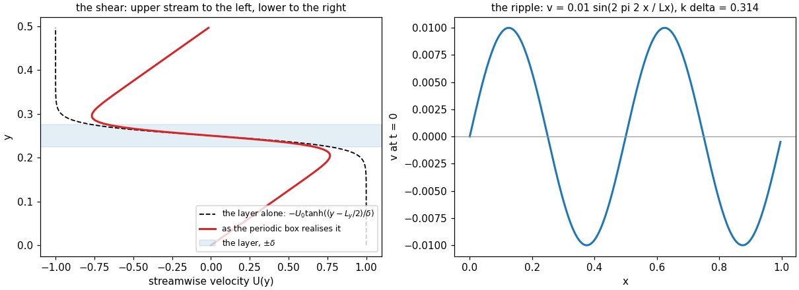
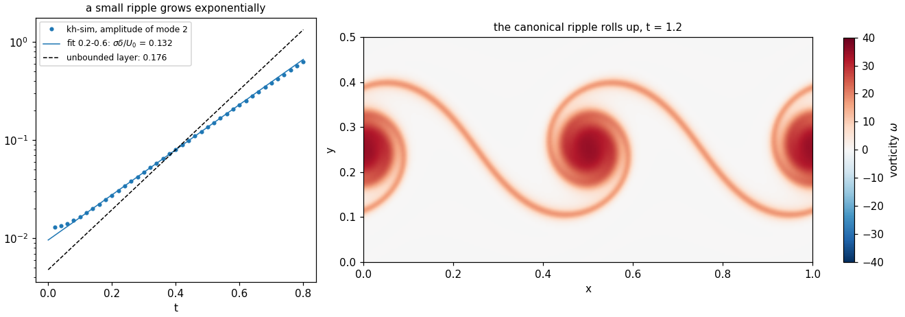
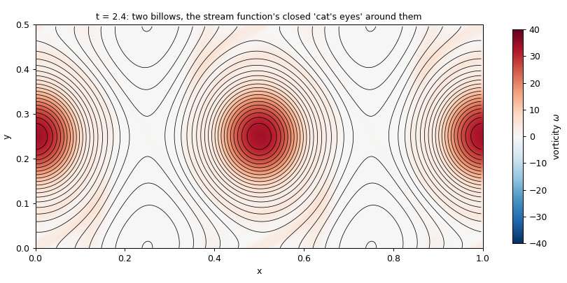

# Chapter 1 — The billows

*License: CC-BY-SA-4.0 (text); the example script is Apache-2.0.*

## §1. You have seen this

You have seen this instability. Almost everyone has, usually without being told it had a name.

The clearest place is the sky. Every so often a cloud layer develops a row of identical curls along its top edge — a line of breaking waves that never break, each one rolled over in the same direction, evenly spaced, holding still long enough to photograph. Meteorologists call them *fluctus*; everyone else calls them "those cloud waves". They are the Kelvin–Helmholtz instability, made visible because the water droplets happen to be sitting exactly where the swirl is.

> *Placeholder for a photograph of billow clouds (fluctus), credited and licensed; to be sourced. Until then, any search for "Kelvin–Helmholtz clouds" will show you what the chapter means, and several of the results are better than anything a placeholder could promise.*

The less clear places are everywhere else. Pour milk into coffee and watch, before you stir, how the boundary between the two fluids ruffles into little scrolls. Blow smoke and watch the straight column, a few centimetres up, lose its nerve and curl. Watch a flag: the ripple travelling down it is a cousin of the same phenomenon, air moving at different speeds on either side of something that would rather stay flat. Anywhere two streams of fluid slide past each other at different speeds, the surface between them is living dangerously.

### Why the smooth thing will not stay smooth

Here is the mechanism, and it is worth having in your bones before any equation shows up.

Start with two layers sliding past each other, with a perfectly flat boundary between them. Now give that boundary the tiniest ripple. A ripple has crests and troughs. Where the boundary bulges up into the upper stream, that stream has to squeeze over the bump, and a fluid squeezed through a narrower gap speeds up — and, this being the part that does the damage, *its pressure drops*. Where the boundary dips down, the upper stream spreads out, slows, and its pressure *rises*. The lower stream does the same thing in mirror image.

So now the crest has low pressure above it, and the trough has high pressure above it. Low pressure pulls the crest further up; high pressure pushes the trough further down. The ripple you started with does not die away — it gets *bigger*. A bigger ripple squeezes the flow harder, which grows it faster still. That runaway is the instability. The shear then takes the growing wave and rolls it over on itself, and you get the curl — the billow — that you saw in the cloud.

The only thing that fights this is viscosity, smearing the sharp differences out before they can run away. Whether the instability wins or viscosity wins is decided by a single number, the Reynolds number, which measures how little the fluid's stickiness matters. High Reynolds number: the billows win. Low: viscosity wins, and the ripple dies quietly.

## §2. The data

kh-sim does not take a photograph of a cloud as input. It takes a description of the flow at the start, and that description has two parts.

**The shear.** Real shear layers do not have an infinitely sharp boundary; the speed changes over some thickness. kh-sim uses the smoothest honest version of that, a `tanh` profile: an S-curve from one stream's speed to the other's over a width δ. In the example below the box is 1.0 wide and 0.5 tall, the layer sits in the middle, δ is 0.025, and the upper stream moves left while the lower one moves right, both at speed 1. The `tanh` is not a cosmetic choice. It is the one profile for which a mathematician in 1964 (Michalke, whose name will recur) worked out *exactly* how fast a ripple of each size grows. That single fact — an exact answer to compare against — turns kh-sim from an animation into an experiment.

**The ripple.** A small sideways wobble, `v = A sin(2π m x / L_x)`: amplitude A = 0.01, m = 2 wavelengths across the box. In the language of the theory, the ripple's wavenumber times the layer width, kδ, is π/10 ≈ 0.314 — comfortably in the range where ripples grow (anything below kδ = 1).



*Figure 1. Left: the shear profile. The dashed curve is the layer on its own, as the formula writes it. The red curve is what the simulation actually works with — and it is not the same thing, which deserves a paragraph. Right: the ripple, two wavelengths across the box.*

The box repeats itself in both directions: whatever leaves through the top comes back in at the bottom. That is what makes the mathematics fast (the [engineer tier](../engineer/en/02-numerical-methods.md) explains why), and it has a price. A single shear layer is not periodic: the upper stream would have to move left at the top of the box and right at the bottom, which is the same place. The simulation resolves the contradiction quietly, by adding a gentle uniform counter-shear across the whole box, which brings the velocity back to zero at the top and bottom. The red curve is the result: the streams on either side of the layer reach only about three quarters of their nominal speed before the counter-shear takes them back down. Hold on to that number. It comes back in §4.

## §3. The result

Run the script ([§5](#5-what-you-can-try-yourself)) and kh-sim integrates the flow forward on a 256 × 128 grid at a Reynolds number of 10 000. Two things happen, one small and one large.

The small thing first. The script runs a second, much quieter copy of the flow with a ripple a hundred times smaller (A = 0.0001), small enough that nothing nonlinear happens for a while, and tracks how tall the ripple is. On a logarithmic axis, exponential growth is a straight line, and a straight line is what appears:



*Figure 2. Left: the height of a very small ripple against time, on a logarithmic axis. After a brief settling-in it grows along a straight line — exponential growth — at a rate σ. The dashed line is the rate the textbook gives for an unbounded tanh layer. Right: the canonical ripple (A = 0.01) at t = 1.2, rolled up into two billows; the colour is the vorticity, the local spin of the fluid.*

The large thing is the roll-up. The ripple steepens, the crests are carried one way and the troughs the other, and the thin sheet of spinning fluid that was the shear layer winds itself into two tight spirals — one per wavelength of the ripple. By t = 2.4 the spirals have swallowed most of the sheet:



*Figure 3. The billows at t = 2.4, with the stream function drawn over them. Fluid moves along the black lines. Around each billow the lines close into an eye-shaped loop — the "cat's eye" — and between the billows they cross in an X. Fluid inside an eye goes round with its billow; fluid outside goes past. This is the pattern that the cloud draws in water droplets.*

The script also prints what it measured. On a reference machine:

<!-- c1-output -->
```text
k*delta                      = 0.3142
measured sigma*delta/U0      = 0.132  (t = 0.2 .. 0.6, Re = 10000)
unbounded tanh layer         = 0.176
ratio                        = 0.75
t = 1.2   kinetic_energy = 0.1115  enstrophy = 39.86  max_vorticity = 34.84  divergence_rms < 1e-10: True
t = 2.4   kinetic_energy = 0.1051  enstrophy = 32.21  max_vorticity = 33.65  divergence_rms < 1e-10: True
wrote …/docs/shad/figures/c1-shear-layers-fig{1,2,3}.png
```

(The last line names the directory the figures went to; everything above it should match your run digit for digit, and the test suite checks that it does.)

## §4. The takeaway

The ripple grew exponentially, and then rolled up into billows with cat's-eye streamlines. That much is the textbook, and kh-sim reproduces it. The interesting line is the third and fourth of the printout: the ripple grew at **three quarters** of the textbook rate.

This is not a bug, and it is worth understanding why, because it is the most useful thing in the chapter. The textbook number belongs to a shear layer with nothing else in the universe: two infinitely deep streams at full speed on either side. The simulated layer lives in a box that repeats itself, with the counter-shear of §2 taking its streams down to about three quarters of their nominal speed. A ripple feels the speed difference across it; the speed difference is about three quarters of the nominal one; the ripple grows at about three quarters of the nominal rate. The simulation is right about the flow it was given. The flow it was given is not the textbook's.

So what is kh-sim telling you about your real-world shear layer, and what not?

- **Yes:** the mechanism — exponential growth of the ripple, roll-up into one billow per wavelength, cat's eyes. These are robust, and kh-sim gets them for the right reasons.
- **Yes, with care:** numbers. A growth rate from kh-sim is a growth rate for kh-sim's flow — the box, the profile, the Reynolds number. To compare one with a textbook, build a flow that is the textbook's. kh-sim's own test does exactly that: a box tall enough that the layer cannot feel the walls it does not have, a ripple shaped like the instability's own preferred shape, and a series of Reynolds numbers extrapolated to the inviscid limit. Done that way, six independent implementations all land on Michalke's number to the fourth digit ([engineer tier, chapter 01 §6](../engineer/en/01-what-kh-sim-computes.md)).
- **No:** anything three-dimensional (real billows eventually break up into three-dimensional turbulence, which a two-dimensional fluid cannot do), anything about density (real billow clouds sit in air whose density changes with height, and buoyancy can switch the instability off altogether — the Richardson number decides), and anything near a wall.

The pretty picture is the reward. The 0.75 is the lesson: a number from a simulation is a statement about the simulated flow, and the work is in knowing which flow that is.

## §5. What you can try yourself

From the kh-sim directory:

```sh
python examples/shad/c1-shear-layers/main.py
```

It needs Python 3.10+, NumPy and Matplotlib, takes about a minute, and writes the three figures into `docs/shad/figures/` (or wherever `--outdir` points). The interesting knobs are at the top of [`examples/shad/c1-shear-layers/main.py`](../../examples/shad/c1-shear-layers/main.py):

| Knob | Try | What to expect |
|---|---|---|
| `MODE` | 1, 3, 4 | One, three, four billows. The growth rate changes with kδ; the box's counter-shear changes it too |
| `MODE` | 7 | kδ = 1.1, past the cut-off: the ripple does not grow, and nothing rolls up |
| `RE` | 1000 | Viscosity wins most of the race: slow growth, fat and lazy billows |
| `RE` | 40000 | Faster growth, thinner spirals; at some point the grid can no longer keep up, and the engineer tier's warnings start to matter |
| `AMP_ROLLUP` | 0.001 | The same billows, later — the ripple needs more e-foldings to get big |

After any change, look at the printout before the pictures. If `max_vorticity` or `enstrophy` ever goes *up* between the two reported times, the run is not healthy, whatever the figures look like (the [engineer tier, chapter 01 §5](../engineer/en/01-what-kh-sim-computes.md), has the reasons).

## §6. Where to next

- **The same physics with the equations attached:** [engineer tier, chapter 01 — What kh-sim actually computes](../engineer/en/01-what-kh-sim-computes.md).
- **Running kh-sim on your own initial field:** [engineer tier, chapter 00 — Quick start](../engineer/en/00-quick-start.md).
- **The rigorous version of the mechanism:** the vorticity-transport and Rayleigh stability equations in [`../../shared/canonical-equations/`](../../shared/canonical-equations/).
- **Next in this guide** (queued for v0.1.x): the vortex and the stream; reading the growth rate; why six languages; and shear layers in the wild — clouds, oceans, jets.

---

**Previous:** [Prologue](00-prologue.md)
