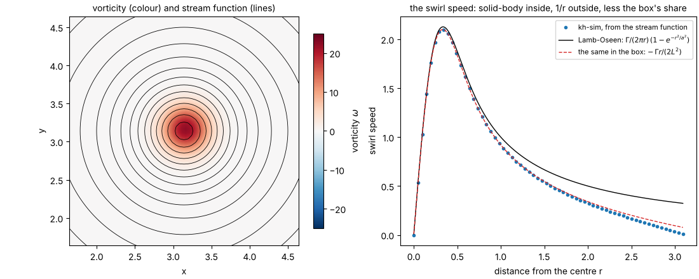
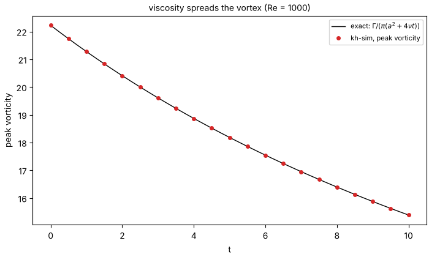
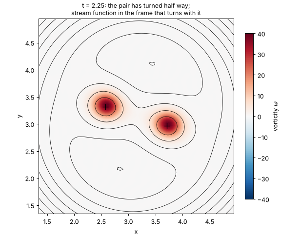

# Chapter 2 — The vortex and the stream

*License: CC-BY-SA-4.0 (text); the example script is Apache-2.0.*

## §1. Two numbers instead of three

To describe a moving fluid in a flat world, the obvious recipe is three numbers at every point: how fast the fluid moves sideways, how fast it moves up and down, and the pressure. The equations that govern those three are famous and unkind. The pressure is the worst of them. It does not move with the fluid and does not spread like heat. It adjusts instantly, everywhere at once, so that the fluid never piles up anywhere, and computing it means solving a puzzle over the whole box at every step.

kh-sim does not use that recipe. It uses two numbers, and neither of them is the pressure.

**The first is the vorticity**, written ω (omega): how fast the fluid at a point is spinning. Drop a tiny paddle wheel into the flow; its rotation rate, doubled, is the vorticity there. A straight, uniform stream has none. The thin sheet in the middle of chapter 1's shear layer is full of it, because that is where the stream above and the stream below shear past each other. A billow is a place where a lot of vorticity has gathered and is going round.

Vorticity has a property that makes it a gift. In a fluid without friction, in two dimensions, a parcel of fluid keeps its vorticity: the spin is carried along with the parcel like a dye. With friction (viscosity), the spin also leaks to the neighbours, the way heat spreads through a pan. Carried and spread: that is the whole life of vorticity, and it is one equation ([KH-GE-1](../../shared/canonical-equations/kh-governing-equations.md)).

**The second is the stream function**, written ψ (psi). Draw its contour lines over the flow, and the fluid moves *along* them, never across them. Where the lines crowd together the fluid is fast; where they spread out it is slow. The stream function is a map of the flow with the traffic rules built in. Since the fluid only ever slides along the lines, it cannot pile up anywhere. That is the very job the pressure was doing in the three-number recipe, done here by geometry.

The two are tied together by one rule: the vorticity is how sharply the stream function curves ([KH-GE-2](../../shared/canonical-equations/kh-governing-equations.md)). Give kh-sim the vorticity, and it reconstructs the stream function from it. That step is a Poisson problem, and it is cheap in a box that repeats itself, because it is one division per Fourier mode. From the stream function it reads off the velocity, moves the vorticity on by a small step, and repeats. The pressure never appears. It can be computed afterwards from the flow, if someone asks; nothing in the simulation needs it.

This chapter tries the two numbers on the simplest flows there are, single vortices, where the exact answers are known.

## §2. The data

The box is 2π on each side, repeating in both directions, on a 128 × 128 grid. The Reynolds number is 1000, so the viscosity ν is 0.001.

**One vortex.** A round blob of vorticity with a Gaussian profile: strongest in the middle, fading smoothly outwards, with a core radius *a* = 0.3. Its total spin, the circulation Γ, is 2π. This is the Lamb–Oseen vortex. Oseen worked out in 1911 exactly what viscosity does to it, and Lamb's textbook made it standard: it stays a Gaussian, the core widens, and the peak vorticity falls as Γ / (π (a² + 4νt)). That formula is the measuring stick.

**Two vortices.** Two such blobs, each with circulation 2π, smaller cores (a = 0.2), side by side at a separation of 1.2. They spin the same way. Each one sits in the other's flow, so each is carried round the other, and the pair orbits its midpoint. If both were points rather than blobs, in an endless plane, the orbit rate would be Γ / (π d²) = 1.389 radians per unit time, a classical result going back to Helmholtz (1858).



*Figure 1. Left: the single vortex. The colour is the vorticity, and the black lines are the stream function: circles, so the fluid goes round and round. Right: the swirl speed against the distance from the centre. Inside the core the fluid turns like a solid wheel, speed growing with radius. Outside, the speed falls off as 1/r, the way a bathtub drain's swirl does. The dots are what kh-sim reads off its stream function. Near the core they sit on the formula (black). Further out they fall below it and follow the red dashed line. The next paragraph explains why.*

The red dashed line is a quiet lesson about the box, and it is the same lesson as chapter 1's counter-shear. A box that repeats itself cannot hold a net amount of spin. The vortex's flow would have to circle each copy of the box one way, and on the shared edge between two copies it would have to go both ways at once. So when kh-sim reconstructs the stream function, it drops the average vorticity. That is exactly as if the vortex sat in a faint, uniform sea of opposite spin, −Γ/L², spread over the whole box. That sea turns everything gently backwards, by Γr/(2L²) at distance r, and the dots follow the formula *less* that share. The vortex itself is untouched; its surroundings are not.

## §3. The result

Run the script ([§5](#5-what-you-can-try-yourself)). First, the single vortex, left alone for ten time units:



*Figure 2. The peak vorticity of the single vortex against time. The line is the exact Lamb–Oseen answer; the dots are kh-sim. Viscosity spreads the spin outwards, and the peak falls by a third in ten time units.*

Then the pair, for about one orbit:



*Figure 3. The pair at t = 2.25, after almost half a turn (the crosses are the two peaks). The black lines are the stream function seen by an observer turning with the pair. In that frame, fluid near each vortex circles it. Fluid further out circles both, along the large closed loops. Between the two families, lines pass through a crossing on each side. It is the cat's-eye pattern of chapter 1 again: in a shear layer the billows sit along a line, and here the two vortices sit on a turning wheel.*

The script prints what it measured. On a reference machine:

<!-- c2-output -->
```text
one vortex: circulation 6.2832, core a = 0.3, Re = 1000 (nu = 0.001)
t =  0.0  peak vorticity =  22.2222  Lamb-Oseen =  22.2222  ratio = 1.0000
t =  2.5  peak vorticity =  20.0000  Lamb-Oseen =  20.0000  ratio = 1.0000
t =  5.0  peak vorticity =  18.1818  Lamb-Oseen =  18.1818  ratio = 1.0000
t =  7.5  peak vorticity =  16.6667  Lamb-Oseen =  16.6667  ratio = 1.0000
t = 10.0  peak vorticity =  15.3846  Lamb-Oseen =  15.3846  ratio = 1.0000
the pair: separation 1.2, cores 0.2, t = 0 .. 4.5
separation                   = 1.199 .. 1.172
two point vortices, alone    = 1.389  (Gamma / (pi d^2), d = 1.2)
the same in the box          = 1.256  (minus Gamma / L^2, d as measured)
measured orbit rate          = 1.282
ratio measured / box         = 1.021
divergence_rms < 1e-10: True
wrote …/docs/shad/figures/c2-vortex-and-stream-fig{1,2,3}.png
```

(As in chapter 1, everything above the last line should match your run digit for digit, and the test suite checks that it does.)

## §4. The takeaway

The single vortex is the cleanest result in this guide: kh-sim follows the exact formula to every printed digit, for ten time units. The reason is worth a sentence. At the centre of a round vortex, the vortex's own flow carries nothing anywhere, because the flow is going round, not in or out. So the peak changes by spreading alone, and spreading is the one thing a spectral method does essentially perfectly. A test that a solver passes for such a clean reason is a good test to have, because a solver that fails it is broken in a basic way.

The pair is the more instructive result, and it has the same shape as chapter 1's three quarters:

- **Alone in the plane**, two point vortices at this separation would orbit at 1.389.
- **In the box**, they cannot. The box holds no net spin, so the pair sits in a uniform sea of opposite spin, −2Γ/L², which turns it back by Γ/L². Viscosity also draws the two cores slowly together, from a separation of 1.199 to 1.172, which speeds the orbit up. With both effects, the prediction for *this* flow is 1.256.
- **kh-sim measures 1.282**, two per cent above it. The remainder comes from the finite cores and the copies of the pair in the neighbouring boxes, which the simple prediction leaves out.

So the lesson repeats, and it is the one to keep: before comparing a simulated number with a formula, ask which flow the formula describes. "Two vortices in an endless plane" is not "two vortices in a box that repeats itself and holds no net spin". The difference here is ten per cent, and it is not an error. It is physics of the box, and the box is part of the experiment.

Two more things this chapter shows without saying so:

- **The last line of the printout.** The divergence of the velocity is zero to round-off. That is the "no piling up" of §1, and it holds by construction, since the velocity is read off the stream function. No step of the method enforces it separately.
- **Viscosity sets the clock.** At Re = 1000 the single vortex loses a third of its peak in ten time units. At Re = 100 it would lose most of it. The orbiting pair keeps its separation for a long time only because its cores spread slowly.

What the chapter does *not* show: a pair that starts close enough does not orbit for long. The two cores reach into each other and merge into one. For the sharp-edged vortex patches of kh-sim's testbed C, the critical separation is about 3.3 radii, and the testbed tells that story with numbers ([engineer tier, chapter 02](../engineer/en/02-numerical-methods.md)). For the soft Gaussian cores here, try it below.

## §5. What you can try yourself

From the kh-sim directory:

```sh
python examples/shad/c2-vortex-and-stream/main.py
```

It needs Python 3.10+, NumPy and Matplotlib, takes about a minute, and writes the three figures into `docs/shad/figures/` (or wherever `--outdir` points). The knobs are at the top of [`examples/shad/c2-vortex-and-stream/main.py`](../../examples/shad/c2-vortex-and-stream/main.py):

| Knob | Try | What to expect |
|---|---|---|
| `RE` | 100 | The single vortex spreads ten times faster; the pair's cores grow into each other within the orbit |
| `D_PAIR` | 0.6 | Three core radii: by t = 2 the pair has merged into one vortex instead of orbiting. Watch figure 3; the orbit rate no longer means anything |
| `D_PAIR` | 2.4 | Twice as far: the orbit is four times slower, and the box's correction Γ/L² becomes a larger share of it |
| `CORE` | 0.1, then 0.05 | At 0.1, two grid cells, still exact to the printed digit. At 0.05, one grid cell, the grid can no longer draw the Gaussian, and the ratio drifts to 1.007 |

## §6. Where to next

- **The equations of §1, written out:** [KH-GE-1 to KH-GE-3](../../shared/canonical-equations/kh-governing-equations.md), and the code that implements each of them.
- **The same form in the engineer's words:** [engineer tier, chapter 01 §1](../engineer/en/01-what-kh-sim-computes.md).
- **Next in this guide:** reading the growth rate, which turns chapter 1's single number into a curve and the curve into a test of the code.

---

**Previous:** [Chapter 1 — The billows](01-the-billows.md) · **Next:** [Chapter 3 — Reading the growth rate](03-reading-the-growth-rate.md)
