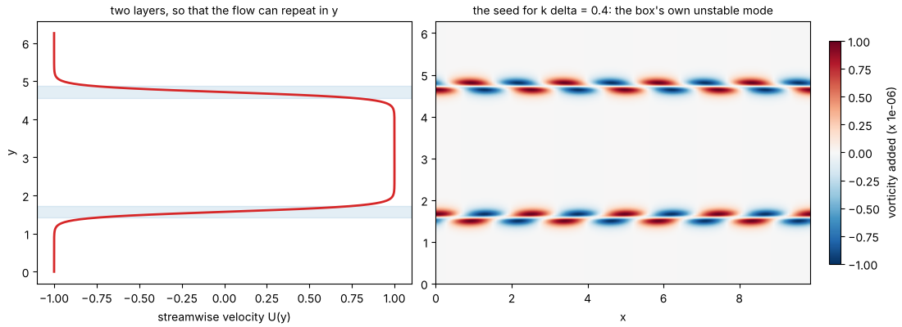
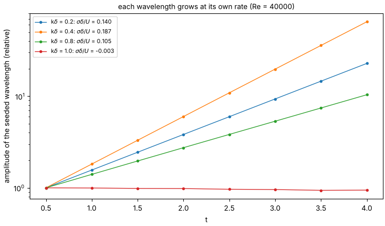
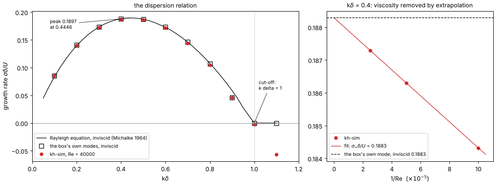

# Chapter 3 — Reading the growth rate

*License: CC-BY-SA-4.0 (text); the example script is Apache-2.0.*

## §1. One number becomes a curve

Chapter 1 measured one number: a ripple of one size grew at a rate σ. A ripple of a different size grows at a different rate. Very long ripples grow slowly, because the pressure pattern of §1 of that chapter is spread so thin that it pushes weakly. Very short ripples do not grow at all, because a ripple much shorter than the thickness of the layer does not feel the layer as a jump in speed, only as a gentle slope. In between there is a fastest-growing size.

Plot the growth rate against the ripple's size and you get a hump: zero at the long end, a peak, and zero again at a definite cut-off. Physicists call that curve the *dispersion relation*. For the `tanh` shear layer it was computed exactly by Alfons Michalke in 1964. The peak is at a ripple whose wavenumber times the layer's thickness, kδ, is 0.4446, where σδ/U = 0.1897. The cut-off is at kδ = 1, where the growth rate falls to zero.

This chapter measures that curve with kh-sim, one ripple size at a time, and lays it over Michalke's. If the dots fall on the line, the solver gets the hardest part of shear-flow physics right. If they do not, *how* they miss tells you what is wrong.

## §2. The data

Three choices make the measurement clean. Each one is a lesson from chapters 1 and 2.

**Two layers, not one.** A box that repeats itself in the vertical direction cannot hold a single jump from "right" to "left": the jump has to come back somewhere. Chapter 1 let the box add a gentle counter-shear across the whole height. That cost a quarter of the growth rate. Here the box holds two mirror-image layers, a quarter and three quarters of the way up. The flow goes right, then left, then right again, and repeats honestly. The layers are thin (δ = L_y/40), and they sit twenty thicknesses apart, so they barely feel each other.

**A box sized to the ripples.** The box is π² ≈ 9.87 wide. That odd number is chosen so that a ripple of m wavelengths across it has kδ = m/10 exactly. Ripples 1 to 11 sample the curve from kδ = 0.1 to 1.1, past the cut-off.

**The right ripple.** Chapter 1 started its ripple as a plain sideways wobble. The flow then spent the first few moments rearranging it into the shape the instability prefers. Here the script first asks: for this box and this ripple size, what is the shape that grows fastest, and how fast does it grow? This is the box's own unstable mode, a small eigenvalue problem on the grid. The script then starts kh-sim from exactly that shape, a millionth as strong as the shear. There is no rearranging, and growth is exponential from the first moment. At kδ = 1.0 and 1.1 there is no such shape: every mode the box has there is neutral, and asking for the fastest one returns whichever neutral mode the round-off of the eigenvalue solver favours, a different one on different computers. Those two ripples start from a plain wobble on the two layers instead, the same on every machine.



*Figure 1. Left: the flow the box holds: right in the middle, left above and below, with two thin layers (shaded) where it changes. Right: the seed for kδ = 0.4, the box's own fastest-growing mode. Its vorticity sits on the two layers and is tilted against the shear. That tilt is the signature of a mode that draws energy from the shear.*

The grid is 128 points across and 256 up, finer in the vertical direction because the layers are thin. The Reynolds number is 40 000.

## §3. The result

For each ripple size the script runs four time units and reads the ripple's strength every half unit:



*Figure 2. The strength of four of the eleven ripples against time, on a logarithmic axis. Each one is a straight line: exponential growth at its own rate. kδ = 0.4 is close to the fastest. kδ = 1.0, the cut-off, does not grow at all and fades slowly under viscosity.*

The slopes of those lines are the growth rates. Plotted against kδ, they draw the curve:



*Figure 3. Left: the measured growth rates (red), the box's own modes from the eigenvalue problem (squares), and Michalke's curve for a single layer in an unbounded fluid (black). Right: one ripple, kδ = 0.4, measured at three Reynolds numbers. The rate lies on a straight line in 1/Re. Followed to 1/Re = 0, an inviscid fluid, it lands on the box's own inviscid mode.*

On a reference machine:

<!-- c3-output -->
```text
box 9.8696 x 6.2832, 128 x 256, delta = Ly/40 = 0.1571, Re = 40000
k*delta   kh-sim   box, inviscid   single layer, inviscid
  0.1      0.0850      0.0852         0.0833
  0.2      0.1403      0.1408         0.1395
  0.3      0.1728      0.1735         0.1731
  0.4      0.1873      0.1883         0.1881
  0.5      0.1866      0.1875         0.1873
  0.6      0.1717      0.1730         0.1729
  0.7      0.1443      0.1460         0.1460
  0.8      0.1049      0.1068         0.1077
  0.9      0.0461      0.0457         0.0587
  1.0     -0.0030      0.0000         0.0000
  1.1     -0.0567      0.0000         0.0000
k*delta = 0.4 at Re = 10000, 20000, 40000: 0.1843, 0.1863, 0.1873
extrapolated to 1/Re = 0       = 0.1883
the box's own mode, inviscid   = 0.1883
single layer (Michalke)        = 0.1881
wrote …/docs/shad/figures/c3-growth-rate-fig{1,2,3}.png
```

## §4. The takeaway

Three columns, three comparisons, and each one says something different.

**kh-sim against the box's own modes.** Across the whole curve, kh-sim grows each ripple about 0.001–0.002 slower than the inviscid prediction for the same box. That is viscosity, and the right panel of figure 3 proves it. At kδ = 0.4, the rate rises in a straight line as the Reynolds number grows. Extended to an inviscid fluid, it lands on 0.1883, the box's own number, to four digits. So the solver has no error left at this level of precision except the one viscosity puts there on purpose.

**The box against Michalke.** At the long end the box's numbers sit slightly *above* the single layer's: 0.0852 against 0.0833 at kδ = 0.1. A long ripple reaches far from its layer, far enough to feel the second layer twenty thicknesses away. Near the peak and beyond, the two agree to within 0.0002. That is the box doing what it was built for: two layers far enough apart to behave as one.

**The last unstable point.** At kδ = 0.9, kh-sim and the box agree with each other (0.0461, 0.0457), and both are *below* Michalke's 0.0587. Near the cut-off, the growing mode squeezes itself into a very thin sheet inside the layer, a *critical layer*, where the ripple travels at the same speed as the fluid. Two hundred and fifty-six points up the box are not enough to draw that sheet. Double them, and the box's mode rises to 0.0582 and kh-sim's to 0.0554. That is no longer a test of the physics. It is a test of the grid, and the grid can fail it while the physics stays right.

That is why the curve is the self-test: each kind of mistake leaves its own fingerprint on it.

- **A wrong viscosity** would bend the 1/Re line of figure 3 (right).
- **A wrong sign** in the advection is the slippery one. The seeded mode, tilted for the right sign, decays at first; then its mirror image, tilted the other way, takes over and grows at the same rate. Measured long enough, the curve comes out the same, because a flow with its advection reversed has the same instability. The curve alone cannot catch this mistake. Chapter 4 is about what can.
- **Missing de-aliasing** would leave the linear curve untouched: it matters only once the ripples are big enough to interact.
- **Too coarse a grid** pulls the curve down near the cut-off first, exactly as at kδ = 0.9, and leaves the peak alone.

When the dots sit on the line everywhere the grid can see, every piece of the solver that the curve can see has done its job.

kh-sim's testbed A does this measurement at full strength. It uses a 256 × 256 grid and five Reynolds numbers, measures kδ = 0.4 and 0.5, and fits the inviscid limit. All six implementations land on σδ/U = 0.18818 at kδ = 0.4, against the theory's 0.1883 for that box and Michalke's 0.1881 ([engineer tier, chapter 01 §6](../engineer/en/01-what-kh-sim-computes.md)). This chapter is that test made small enough to run in two minutes.

## §5. What you can try yourself

From the kh-sim directory:

```sh
python examples/shad/c3-growth-rate/main.py
```

It needs Python 3.10+, NumPy, SciPy and Matplotlib, takes about two minutes, and writes the three figures into `docs/shad/figures/` (or wherever `--outdir` points). The knobs are at the top of [`examples/shad/c3-growth-rate/main.py`](../../examples/shad/c3-growth-rate/main.py):

| Knob | Try | What to expect |
|---|---|---|
| `NY` | 128 | The layers are three grid points thick. Beyond kδ = 0.7 everything falls below the curve; at kδ = 0.9 the box's own eigenvalue problem no longer finds a growing mode at all, while kh-sim still grows the ripple at 0.035; and at kδ = 1.1, past the cut-off, the ripple grows (0.011): the grid has invented an instability. A coarse grid does not just blur the physics, it can add some |
| `NY` | 512 | kδ = 0.9 climbs towards Michalke's 0.0587 (the run takes several minutes) |
| `RE` | 4000 | Every rate drops by about 0.01; the extrapolation still lands on the inviscid value |
| `T_END` | 14 | Near the end the fastest ripples stop being small: their lines in figure 2 bend over as the billows of chapter 1 begin to form, and the fitted rate slips below the linear one |

## §6. Where to next

- **The theory, written out:** the Rayleigh equation and Michalke's solution in [`../../shared/canonical-equations/kh-linear-stability.md`](../../shared/canonical-equations/kh-linear-stability.md).
- **The full test, its box, and why the seed is the box's own mode:** [engineer tier, chapter 01 §6](../engineer/en/01-what-kh-sim-computes.md).
- **Next in this guide:** why six languages. The curve of this chapter tells you that *a* solver is right. It cannot tell you that six of them compute the same flow, and chapter 4 tells the story of the bug that only element-by-element comparison caught.

---

**Previous:** [Chapter 2 — The vortex and the stream](02-the-vortex-and-the-stream.md) · **Next:** [Chapter 4 — Why six languages](04-why-six-languages.md)
