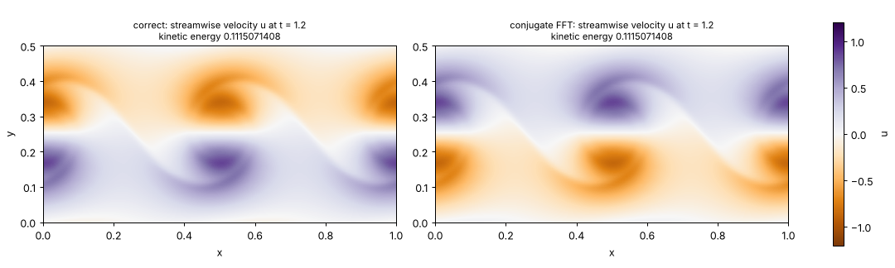
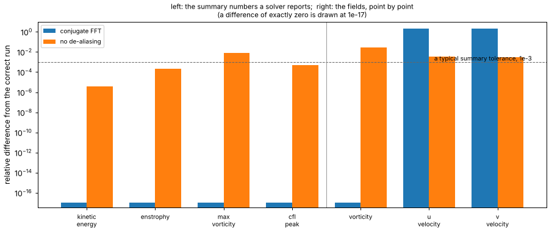

# Chapter 4 — Why six languages

*License: CC-BY-SA-4.0 (text); the example script is Apache-2.0.*

## §1. The same flow, six times

kh-sim computes the flow of chapters 1 to 3 six times over: in Python, Fortran, Pascal, C++, Rust and Scala. That looks like a waste of effort, and it would be if the goal were a fast solver. The goal is a solver you can trust, and trust needs a second opinion that does not share the first one's mistakes.

The six are not equals. The Python version is the *reference*: the shortest path from the equations to code, and the one whose output every other version is compared against. Three versions (C++, Fortran, Pascal) write the Fourier transform out by hand, a few lines of arithmetic that a reader can check with a pencil. Two (Rust, Scala) call well-known Fourier libraries that share no code with anything else in the project. If all six produce the same flow, a shared mistake would have to live in the equations themselves, and chapters 2 and 3 checked the equations against textbook physics.

That is the argument on paper. This chapter is about what actually happened, because the first time the six were compared properly, four of them were wrong.

## §2. The data

Two bugs, both of which kh-sim really had, are put back into this chapter's copy of the Python reference for the length of one run each.

**The conjugate transform.** A Fourier transform has a sign convention: the forward transform multiplies by exp(−2πi kn/N), the inverse by exp(+2πi kn/N). Swap the two and you still have a perfectly good transform pair. A transform followed by its inverse still returns the input exactly, so every round-trip test passes. But everything computed in between is the complex conjugate of what it should be, and a derivative taken that way comes out with the wrong sign. The hand-written transforms in C++, Fortran and Pascal all had this convention, each written independently, each looking right.

**The missing 2/3 rule.** Chapter 2's method multiplies fields together to form the nonlinear term, and a product of two waves contains waves twice as fine as either. On a grid, waves finer than the grid can draw do not disappear; they fold back and pose as coarser ones. The standard cure, the *2/3 rule*, throws away the top third of the wavenumbers before multiplying. The Rust version once left it out.

The script runs chapter 1's billows (128 × 64, Re = 10 000, to t = 1.2, mid roll-up) three times, as shipped and with each bug, and compares each wrong run with the right one in two ways. First, by the four summary numbers a solver reports: kinetic energy, enstrophy, peak vorticity and peak Courant number. Second, point by point: every grid value of the vorticity and of both velocity components, against the same point of the right run.

## §3. The result



*Figure 1. Left: the streamwise velocity of the right run at t = 1.2. Right: the same quantity from the run with the conjugate transform. Every colour is reversed: where the fluid moves right it now reports moving left. The kinetic energy above each panel is the same to ten digits.*



*Figure 2. How far each wrong run lands from the right one, on a logarithmic scale. Left of the grey line: the four summary numbers. Right of it: the three fields, point by point. Bars drawn at the bottom are differences of exactly zero. The dashed line marks 1e-3, a typical tolerance for a summary check.*

On a reference machine:

<!-- c4-output -->
```text
chapter 1's billows, 128 x 64, t = 1.2; relative difference from the correct run
                   conjugate FFT  no de-aliasing
kinetic_energy           0.0e+00         3.9e-06
enstrophy                0.0e+00         2.0e-04
max_vorticity            0.0e+00         8.0e-03
cfl_peak                 0.0e+00         4.9e-04
vorticity                0.0e+00         2.7e-02
u_velocity               2.0e+00         3.6e-03
v_velocity               2.0e+00         3.2e-03
conjugate FFT: u, v exactly reversed: True
wrote …/docs/shad/figures/c4-six-languages-fig{1,2}.png
```

(Everything above the last line should match your run digit for digit; the test suite checks it.)

## §4. The takeaway

**The conjugate transform is invisible to every number but one.** Its four summaries are not close to the right ones; they *are* the right ones, bit for bit. So is the vorticity, at every point. Only the velocity is wrong, and it is wrong completely: reversed everywhere, a relative difference of 2.0, which is as far apart as two fields of the same size can be.

The reason is worth following, because it is the whole trap. The wrong transform flips the sign of every derivative. The velocity is one derivative of the stream function, so it comes out reversed. But the vorticity is carried along by the velocity *across its own slope*, and its slope is a derivative too, also reversed. Two reversed factors make a correct product, so the vorticity evolves exactly as it should. Viscosity and the stream-function step of chapter 2 use the square of the wavenumber, which has no sign to lose. The energy is a sum of squared velocities, the Courant number uses their sizes: neither can tell left from right. Chapter 3 noted that a single sign error in the advection hides in the growth-rate curve. Here two sign errors hide from everything that is a total, a maximum or a square.

In kh-sim's history, the three hand-written transforms reported exactly this. Their energies and enstrophies matched the reference to the last digit; their vorticity matched too. One of them was used for several rounds of development in that state. What caught all three was the first comparison of the velocity fields, point by point, against the reference's *golden vectors*: nine stored reference runs that keep, besides the summaries, the minimum, maximum and mean of every field and its first and last ten values. All three failed on the velocity, and each was fixed by reversing a single sign.

**The missing 2/3 rule is visible, if you know where to look.** It moves everything, but by different amounts: the energy by four parts in a million, the peak vorticity by almost one per cent, the vorticity field by almost three. A summary check with the usual tolerance of 1e-3 would catch it here through the peak vorticity, and miss it through the energy. At an earlier moment it would miss it altogether: at t = 0.3 the largest summary difference is 7e-5 ([§5](#5-what-you-can-try-yourself)). Whether a summary check catches this bug depends on which number you happen to check, at what moment, and how tight a tolerance you dare to set. A tolerance on summaries has to be loose, because two correct solvers that do arithmetic in different orders do not agree to the last digit.

What catches it reliably is a *tight* tolerance, and a tight tolerance needs a reference that does the same arithmetic. Every kh-sim implementation follows the Python reference operation for operation, so the golden vectors can demand agreement to one part in a billion on the summaries and one in ten million on the field values, a bound that also grows slowly with the grid, as rounding does. At the conditions of golden vector V3 (64 × 32, Re = 10 000, t = 0.1), the missing rule moves the energy by 3e-8 and the enstrophy by 1e-6, thirty and a thousand times that bound, while every field moves by a few parts in a thousand. Rust's missing rule was caught by the same comparison that caught the three transforms.

**Library-backed implementations earn their place differently.** The two versions that call a third-party Fourier library (rustfft in Rust, JTransforms in Scala) had neither transform bug: the libraries are widely used, and their conventions have been checked many times over. That makes them independent witnesses. When a hand-written version and a library version agree element by element, the agreement says something about the equations, not about one person's transform. The hand-written versions are kept anyway, bugs and all, because their arithmetic is four readable lines instead of a library call. The bugs were findable precisely because the arithmetic was on the page.

So the lesson of this chapter is about what a test can see. A sum or a maximum folds a whole field into one number, and some mistakes fold away with it. To know that six programs compute the *same flow*, compare the flow. Since that history, every comparison in kh-sim's suite is element by element, and the textbook testbeds are run once for all six implementations. Chapter 3's testbed A, for one, comes out identical to the printed digit in all six: σ_∞ = 0.18818 at kδ = 0.4 ([engineer tier, chapter 02 §5](../engineer/en/02-numerical-methods.md), which has the full table).

## §5. What you can try yourself

From the kh-sim directory:

```sh
python examples/shad/c4-six-languages/main.py
```

It needs Python 3.10+, NumPy and Matplotlib, takes about twenty seconds, and writes the two figures into `docs/shad/figures/` (or wherever `--outdir` points). The knobs are at the top of [`examples/shad/c4-six-languages/main.py`](../../examples/shad/c4-six-languages/main.py), and the two bugs are the two short functions `conjugate_fft` and `no_dealiasing`:

| Knob | Try | What to expect |
|---|---|---|
| `STEPS` | 300 | t = 0.3, before the roll-up: no summary of the de-aliasing bug reaches 1e-3 (the largest is 7e-5), while the vorticity field is still off by 2e-4 |
| `STEPS` | 2400 | t = 2.4, billows fully rolled: the vorticity field is still off by 1.7 per cent, but the peak vorticity's difference *falls* to 0.17 per cent. A summary difference does not grow steadily with the error |
| `NX`, `NY`, `STEPS` | 64, 32, 100 | The conditions of golden vector V3 (whose Reynolds number, 10 000, the script already uses): every summary of the de-aliasing bug stays below 1e-3 (the energy moves by 3e-8, the peak vorticity by 2e-4); only a tolerance set by rounding sees it in the summaries |

## §6. Where to next

- **The six implementations, the FFT convention and the test layers, in the engineer's words:** [engineer tier, chapter 02 §2, §4 and §5](../engineer/en/02-numerical-methods.md).
- **The golden vectors themselves:** nine reference runs and their tolerances in [`../../shared/golden-vectors/`](../../shared/golden-vectors/README.md).
- **The equations every implementation follows:** [`../../shared/canonical-equations/kh-numerical-methods.md`](../../shared/canonical-equations/kh-numerical-methods.md).
- **Next in this guide** (queued for a later release): shear layers in the wild — clouds, oceans, jets.

---

**Previous:** [Chapter 3 — Reading the growth rate](03-reading-the-growth-rate.md)
